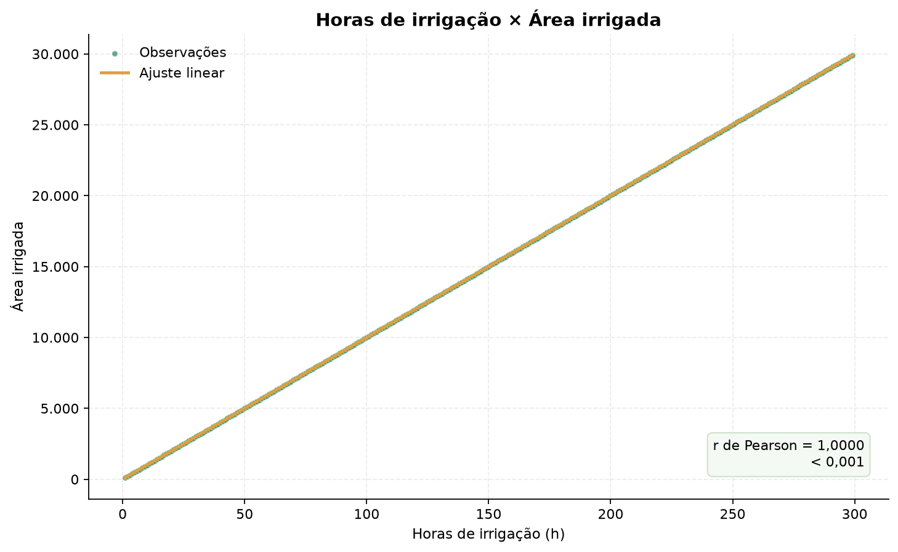
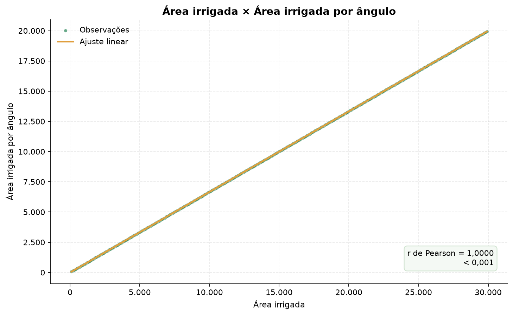
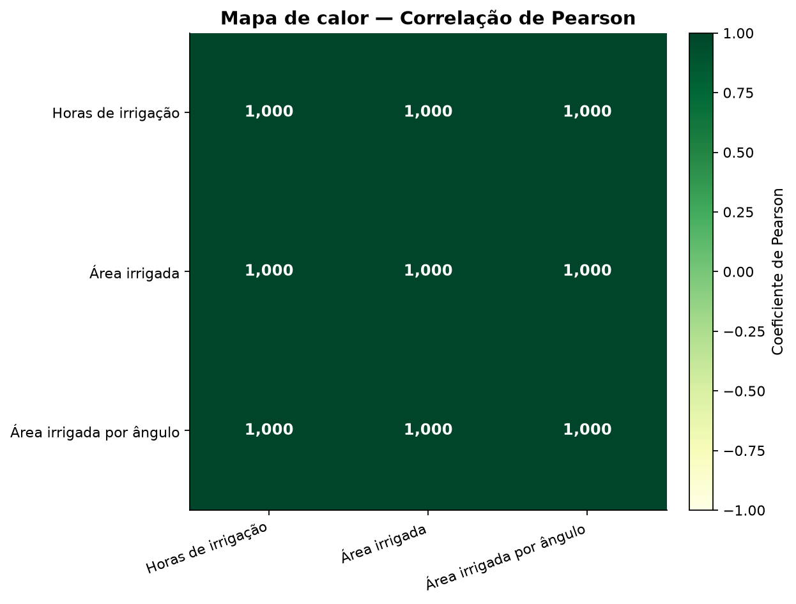
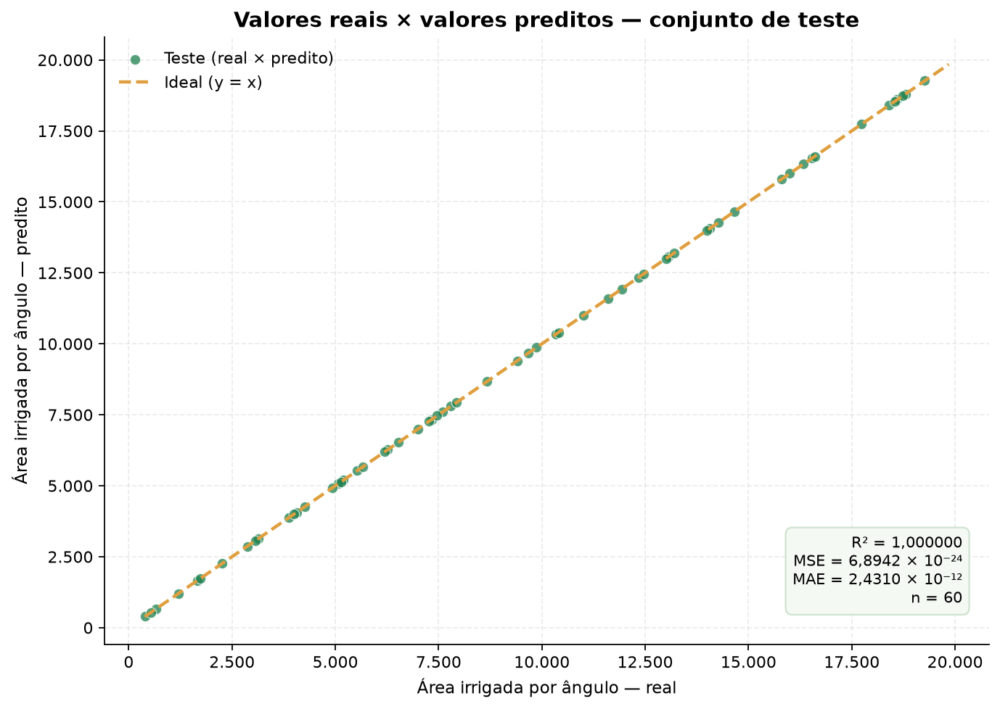
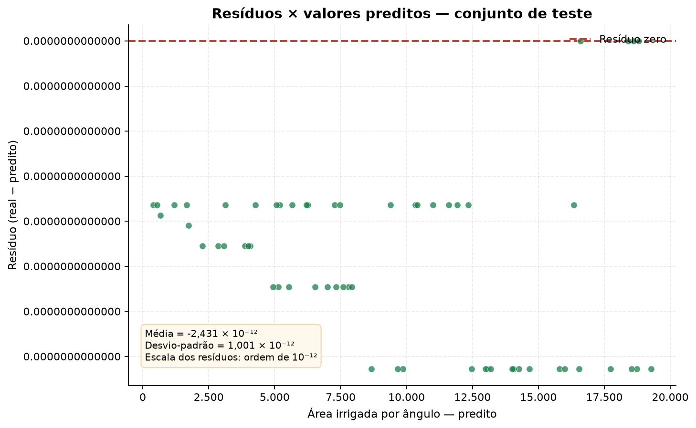
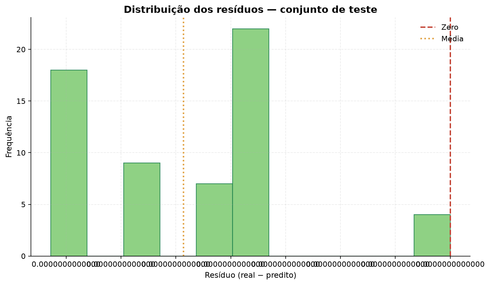
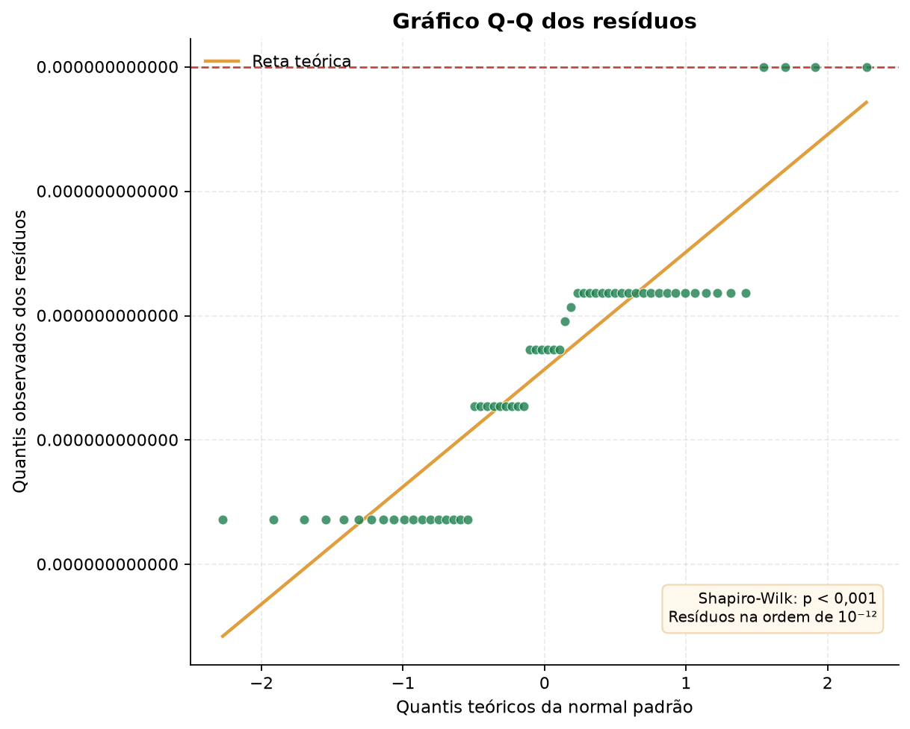
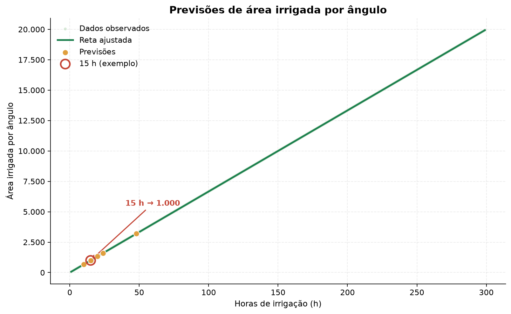

# Sistema de Análise de Irrigação — Relatório

**Data da análise:** 29/10/2026  
**Base de dados:** `Arquivos/dados_de_irrigacao.csv` — 299 registros e 3 variáveis  
**Modelo:** regressão linear simples  
**Variável independente (X):** horas de irrigação  
**Variável dependente (Y):** área irrigada por ângulo

---

## Sumário executivo

A base apresenta **299 registros completos**, sem valores ausentes, duplicatas ou valores negativos. As três variáveis têm correlação linear de **1,0000**, e o modelo de regressão linear obteve **R² = 1,000000** no conjunto de teste, com **MSE = 6,8942 × 10⁻²⁴** e **MAE = 2,4310 × 10⁻¹²**.

A equação ajustada é:

> **Área irrigada por ângulo = 66,6667 × Horas de irrigação + (1,818989 × 10⁻¹²)**

Para **15 horas de irrigação**, a previsão é **1.000,00** de área irrigada por ângulo.

> **Achado central:** a relação entre horas de irrigação e área irrigada por ângulo é **exatamente linear** nesta base (Y ≈ 66,6667·X). Os resíduos ficam na ordem de 10⁻¹², ou seja, são ruído de ponto flutuante, e não uma distribuição estatística real. Isso indica que a base é **determinística/simulada**; o modelo é exato para estes dados, mas essa exatidão **não deve ser extrapolada automaticamente para o campo**, onde há variabilidade climática, do solo, da uniformidade de aplicação e de medição.

---

## 1. Carregamento e qualidade dos dados

- **Registros:** 299
- **Colunas:** Horas de irrigação, Área irrigada, Área irrigada por ângulo
- **Valores ausentes:** 0
- **Linhas duplicadas:** 0
- **Valores negativos:** 0

A base está pronta para análise, sem necessidade de imputação ou remoção de registros.

---

## 2. Estatísticas descritivas

| Variável                 |   N | Média       | Desvio-padrão   | Mínimo   | Q1         | Mediana     | Q3          | Máximo      | CV (%)   | Assimetria     | Curtose   |
|:-------------------------|----:|:------------|:----------------|:---------|:-----------|:------------|:------------|:------------|:---------|:---------------|:----------|
| Horas de irrigação       | 299 | 150,0000    | 86,4581         | 1,0000   | 75,5000    | 150,0000    | 224,5000    | 299,0000    | 57,6387  | 0,0000         | -1,2000   |
| Área irrigada            | 299 | 15.000,0000 | 8.645,8082      | 100,0000 | 7.550,0000 | 15.000,0000 | 22.450,0000 | 29.900,0000 | 57,6387  | 0,0000         | -1,2000   |
| Área irrigada por ângulo | 299 | 10.000,0000 | 5.763,8722      | 66,6667  | 5.033,3333 | 10.000,0000 | 14.966,6667 | 19.933,3333 | 57,6387  | 1,5872 × 10⁻¹⁵ | -1,2000   |

**Leitura:** as variáveis crescem de forma perfeitamente proporcional. A área irrigada é exatamente 100 vezes as horas de irrigação, e a área irrigada por ângulo é exatamente 2/3 da área irrigada. O coeficiente de variação é alto porque a amplitude é grande (1 a 299 horas), não porque haja dispersão em torno da tendência.

---

## 3. Análise gráfica

### 3.1 Horas de irrigação × Área irrigada

### 3.2 Horas de irrigação × Área irrigada por ângulo

### 3.3 Área irrigada × Área irrigada por ângulo

Os três gráficos mostram pontos alinhados sobre uma reta, sem nuvem de dispersão ou outliers. Isso é consistente com uma base gerada por uma regra matemática fixa.

---

## 4. Correlação entre as variáveis

| Variável                 | Horas de irrigação   | Área irrigada   | Área irrigada por ângulo   |
|:-------------------------|:---------------------|:----------------|:---------------------------|
| Horas de irrigação       | 1,0000               | 1,0000          | 1,0000                     |
| Área irrigada            | 1,0000               | 1,0000          | 1,0000                     |
| Área irrigada por ângulo | 1,0000               | 1,0000          | 1,0000                     |

As correlações de Pearson e de Spearman são iguais a 1,0000 entre todos os pares, indicando associação linear positiva perfeita. Do ponto de vista prático, isso significa que as três variáveis carregam praticamente a mesma informação: **horas de irrigação** é suficiente para explicar a área irrigada por ângulo, e usar `área irrigada` como preditora adicional seria redundante (multicolinearidade perfeita).

---

## 5. Divisão treino/teste e modelo

- **Treino:** 239 registros (80%)
- **Teste:** 60 registros (20%)
- **Semente aleatória:** 42

**Equação da reta:**

> **Área irrigada por ângulo = 66,6667 × Horas de irrigação + (1,818989 × 10⁻¹²)**

Coeficiente angular: **66,666667**  
Intercepto: **1,818989 × 10⁻¹²**  
R² treino: **1,000000**  
R² teste: **1,000000**

O coeficiente angular indica que cada hora adicional de irrigação está associada a um aumento de aproximadamente **66,67** na área irrigada por ângulo. O intercepto é numericamente desprezível (≈ 10⁻¹²), como esperado em uma relação proporcional.

---

## 6. Métricas de desempenho

| Métrica              | Valor          |
|:---------------------|:---------------|
| MSE                  | 6,8942 × 10⁻²⁴ |
| MAE                  | 2,4310 × 10⁻¹² |
| RMSE                 | 2,6257 × 10⁻¹² |
| R²                   | 1,0000         |
| MAPE (%)             | 5,3124 × 10⁻¹⁴ |
| Erro absoluto máximo | 3,6380 × 10⁻¹² |

**Leitura:** MSE e MAE são praticamente zero. O R² é 1,000000, ou seja, o modelo explica toda a variabilidade observada. O MAPE é desprezível. Esses resultados confirmam um ajuste perfeito, mas devem ser interpretados com cautela: quando os dados são determinísticos, não há erro aleatório para o modelo aprender/capturar, e as métricas não informam como o modelo se comportaria em dados reais.

---

## 7. Análise dos resíduos

| Métrica                    | Valor           |
|:---------------------------|:----------------|
| Média dos resíduos         | -2,4310 × 10⁻¹² |
| Desvio-padrão dos resíduos | 1,0006 × 10⁻¹²  |
| Resíduo mínimo             | -3,6380 × 10⁻¹² |
| Resíduo máximo             | 0,0000          |
| Soma dos resíduos          | -1,4586 × 10⁻¹⁰ |
| Amplitude                  | 3,6380 × 10⁻¹²  |

Os resíduos variam apenas entre -3,638 × 10⁻¹² e 0,000, com desvio-padrão de 1,001 × 10⁻¹². Essa ordem de grandeza (10⁻¹²) corresponde ao limite de precisão de números de ponto flutuante, não a erro de medição agrícola.

Não há padrão sistemático nos resíduos: eles são essencialmente zero. Em um conjunto real, esperaríamos resíduos distribuídos em torno de zero, com dispersão aproximadamente constante (homocedasticidade). Aqui, a variabilidade é inexistente em escala prática.

---

## 8. Normalidade dos resíduos

| Teste              | Estatística   | p-valor       | Decisão                                |
|:-------------------|:--------------|:--------------|:---------------------------------------|
| Shapiro-Wilk       | 0,8437        | 1,9963 × 10⁻⁶ | Rejeita H₀ (não normal)                |
| D'Agostino-Pearson | 3,3573        | 0,1866        | Não rejeita H₀ (compatível com normal) |
| Jarque-Bera        | 2,7575        | 0,2519        | Não rejeita H₀ (compatível com normal) |

**Interpretação:** os testes entram em conflito porque os resíduos são **numericamente degenerados** (quase todos iguais a zero, com poucos valores distintos de 10⁻¹²). O Shapiro-Wilk rejeita a normalidade, enquanto o D'Agostino-Pearson não rejeita — um comportamento típico de dados quantizados, não de uma distribuição contínua real. Portanto, **não é possível concluir que os resíduos sejam normais ou não**; o teste de normalidade é inadequado para esta base. Em dados reais, essa etapa deveria ser repetida com resíduos em escala mensurável e, se necessário, com transformações ou modelos robustos.

---

## 9. Predições

|   Horas de irrigação | Área por ângulo prevista   | Destaque             |
|---------------------:|:---------------------------|:---------------------|
|                   10 | 666,67                     |                      |
|                   15 | 1.000,00                   | exemplo da checklist |
|                   20 | 1.333,33                   |                      |
|                   24 | 1.600,00                   |                      |
|                   48 | 3.200,00                   |                      |

**Exemplo da checklist:** para **15 horas de irrigação**, a área irrigada por ângulo prevista é **1.000,00**.

---

## 10. Conclusões e recomendações

1. **Relação identificada:** a área irrigada por ângulo é uma função linear exata das horas de irrigação: `Y = 66,6667·X + (1,818989 × 10⁻¹²)`.
2. **Desempenho:** R² = 1,000000, MSE = 6,8942 × 10⁻²⁴ e MAE = 2,4310 × 10⁻¹². O ajuste é perfeito para a base fornecida.
3. **Resíduos:** praticamente nulos (10⁻¹²); não há evidência de padrão, heterocedasticidade ou outliers. Os testes de normalidade não são interpretáveis nessa escala.
4. **Predição de 15 horas:** **1.000,00** de área irrigada por ângulo.
5. **Limitação principal:** a base é determinística/simulada. Um R² = 1 não garante desempenho em condições de campo. Para decisões reais, recomenda-se:
   - coletar dados com variabilidade real (clima, solo, umidade, vazão, eficiência do sistema);
   - incluir variáveis explicativas adicionais;
   - validar com validação cruzada e um conjunto de teste independente;
   - monitorar resíduos ao longo do tempo e testar robustez a outliers;
   - usar o modelo como apoio à decisão, não como substituto da avaliação agronômica.
6. **Recomendação operacional:** dentro do cenário modelado, 15 horas de irrigação correspondem a 1.000,00 de área irrigada por ângulo. Esse valor pode ser usado como referência inicial, mas deve ser confrontado com medições de campo antes de ser adotado como regra de manejo.

---

## 11. Checklist do projeto

| Tarefa da checklist                                            | Onde está               | Status       |
|:---------------------------------------------------------------|:------------------------|:-------------|
| 1. Carregar os dados de irrigação a partir de um CSV           | Seção 1                 | ✅ Concluído |
| 2. Visualizar os dados e as variáveis disponíveis              | Seções 1 e 3            | ✅ Concluído |
| 3. Calcular as estatísticas descritivas                        | Seção 2                 | ✅ Concluído |
| 4. Criar gráficos de dispersão                                 | Seção 3 (figuras 01–03) | ✅ Concluído |
| 5. Analisar a correlação entre as variáveis                    | Seção 4 (figura 04)     | ✅ Concluído |
| 6. Dividir os dados em treino e teste                          | Seção 5                 | ✅ Concluído |
| 7. Treinar a regressão linear (X = horas, Y = área por ângulo) | Seção 5                 | ✅ Concluído |
| 8. Imprimir a equação da reta                                  | Seção 5                 | ✅ Concluído |
| 9. Avaliar com MSE e MAE                                       | Seção 6                 | ✅ Concluído |
| 10. Visualizar resultados reais e preditos                     | Seção 6 (figura 05)     | ✅ Concluído |
| 11. Calcular e analisar os resíduos                            | Seção 7 (figuras 06–07) | ✅ Concluído |
| 12. Verificar a normalidade dos resíduos                       | Seção 8 (figura 08)     | ✅ Concluído |
| 13. Fazer predições (exemplo: 15 horas)                        | Seção 9 (figura 09)     | ✅ Concluído |

---

### Arquivos gerados

- `resultados/figuras/` — 9 figuras em PNG;
- `resultados/tabelas/` — estatísticas, correlações, métricas, resíduos, testes e previsões em CSV;
- `resultados/relatorio.md` — este relatório;
- `resultados/relatorio.html` — versão para navegador e impressão em PDF;
- `resultados/tabelas/resumo_modelo.txt` — coeficientes e equação do modelo.
